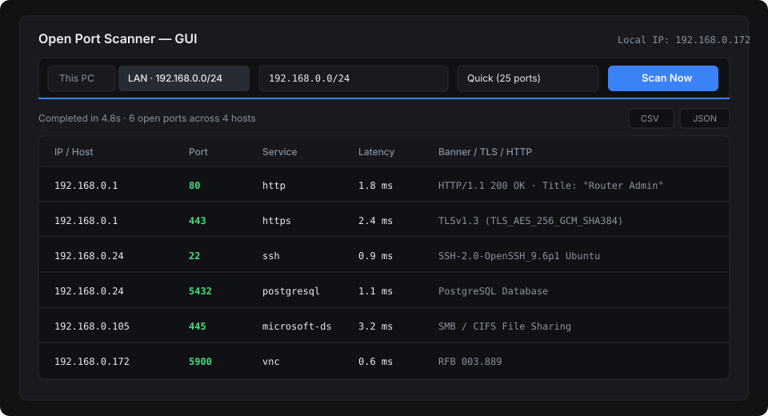

<div align="center">

# Open Port Checker & Fast IP Network Port Scanner (v2.0 — Rust + egui)

**Lightning-fast, native cross-platform tool in Rust (`tokio` + `eframe`/`egui` + `clap`) to scan open TCP ports, map your local LAN in one click, and inspect service banners with GUI & CLI in a single compact binary.**

[](https://github.com/open-port-tools/port-scanner/releases)
[](https://github.com/open-port-tools/port-scanner/actions/workflows/build-binaries.yml)
[](LICENSE)
[]()
[](https://github.com/open-port-tools/port-scanner/stargazers)

[Download](#-quick-start--download) • [Features](#-key-features) • [Comparison](#-why-use-this-over-angry-ip-scanner-or-nmap) • [CLI Examples](#-how-to-check-open-ports-usage-examples) • [Cross-Compile .exe](#-building-locally--cross-compiling-windows-exe) • [FAQ](#-frequently-asked-questions-faq)

</div>

---

## What is Open Port Scanner?

**Open Port Scanner v2.0** is a native **Rust** port scanner and local LAN mapper built for **Windows, macOS, and Linux** using **Tokio** async I/O, an **eframe / egui** GPU-accelerated desktop interface, and a **clap** CLI — compiled into a **single standalone binary (~5–8 MB)** with zero runtime dependencies (no Python, no browser, no Java, no Npcap).

It scans localhost, remote hosts, IPv4 ranges, or your entire local `/24` LAN subnet in seconds using a bounded-concurrency port-major async engine. A legacy zero-dependency Python 3 implementation also remains in the repository for scriptable Python environments.



---

## ✨ Key Features

- **⚡ Native Rust + Tokio Async Engine:** Bounded worker pool (`1–2000` sockets) sweeps hosts in port-major order without file-descriptor exhaustion.
- **🖥️ Distraction-Free Native GPU GUI (`eframe` / `egui`):** Double-click `port-scanner` (or run with no arguments) for an immediate dark-themed desktop UI — 1-click **«Этот ПК»** and **«Вся сеть»**, instant table sorting, live filter, and CSV/JSON export.
- **🌐 1-Click Whole Local Network (LAN) Scan:** Automatically detects your active `/24` LAN subnet (`--lan` in CLI or **«Вся сеть · <cidr>»** in GUI), filtering out loopback (`127.*`), link-local (`169.254.*`), and VPN fake-IP pools (`198.18.0.0/15`).
- **🔍 Open Port Checker & Banner Grabbing:** Maps 120+ well-known TCP services, measures handshake latency in milliseconds, and grabs SSH/FTP/SMTP/VNC greetings plus HTTP status, `Server` headers, and `<title>`.
- **📜 Scriptable CLI + Exports:** Pipe clean `--json` output in automation or export reports directly to `.json`, `.csv`, or `.md` (`-o`).

---

## 📊 Why Use This Over Angry IP Scanner or Nmap?

| Feature | Open Port Scanner v2.0 | Angry IP Scanner | Nmap / Zenmap | Advanced Port Scanner |
| :--- | :---: | :---: | :---: | :---: |
| **Stack & Engine** | 🦀 **Rust (`tokio` + `egui`)** | Java / threads | C++ / Raw | Multi-threaded |
| **Binary Footprint** | ✅ **~5–8 MB Single File** | Requires JVM | Requires Npcap | Installer |
| **Requires Java / Npcap** | ✅ **No (Zero Runtime Deps)** | ❌ Requires JVM | ❌ Requires Npcap | ✅ No |
| **Operating Systems** | **Windows, Mac, Linux** | Windows, Mac, Linux | Windows, Mac, Linux | ❌ Windows Only |
| **1-Click Whole LAN Scan** | ✅ **Built-in (`--lan`)** | Manual IP range | Manual CIDR | Auto subnet |
| **GUI + CLI in One Binary** | ✅ **Both Included** | GUI Only | CLI + Legacy Zenmap | GUI Only |
| **License** | **100% Free (MIT)** | GPL | NPSL | Proprietary Freeware |

---

## 🚀 Quick Start & Download

### Option 1: Download Pre-built Native Executable (~2–4 MB)

Download the standalone binary for your operating system from **[GitHub Releases v2.0.0](https://github.com/open-port-tools/port-scanner/releases/tag/v2.0.0)**:

| OS | Direct Download Link | Archive Size | Contents |
| :--- | :--- | :---: | :--- |
| **Windows (x64)** | [**Download port-scanner-windows-x64.zip**](https://github.com/open-port-tools/port-scanner/releases/download/v2.0.0/port-scanner-windows-x64.zip) | ~2.1 MB | `port-scanner.exe` (Native GPU GUI + CLI) |
| **macOS (Universal)** | [**Download port-scanner-macos.tar.gz**](https://github.com/open-port-tools/port-scanner/releases/download/v2.0.0/port-scanner-macos.tar.gz) | ~4.4 MB | `port-scanner` (Apple Silicon M1–M4 + Intel x86_64) |
| **Linux (x64)** | [**Download port-scanner-linux-x64.tar.gz**](https://github.com/open-port-tools/port-scanner/releases/download/v2.0.0/port-scanner-linux-x64.tar.gz) | ~2.8 MB | `port-scanner` (Native X11/Wayland GUI + CLI) |

Launch GUI directly (double-click or run with no arguments in terminal):
```bash
# macOS / Linux
./port-scanner

# Windows
port-scanner.exe
```

### Option 2: Build from Source with Cargo (Rust 1.75+)

```bash
git clone https://github.com/open-port-tools/port-scanner.git
cd port-scanner

cargo build --release

# Launch native GPU GUI
./target/release/port-scanner

# Or run a fast CLI scan across your local LAN
./target/release/port-scanner --lan --profile quick
```

### Option 3: Legacy Python 3.9+ Fallback (Zero Pip Dependencies)

```bash
python3 scanner.py --lan --profile quick
```

---

## 🛠 How to Check Open Ports (Usage Examples)

### 1. Scan Your Whole Local Network (LAN /24) in 1 Click
Automatically detect your active Wi-Fi/Ethernet subnet and list open services:
```bash
port-scanner --lan --profile quick
```

### 2. Check Specific Open Ports on a Host or IP
```bash
port-scanner scanme.nmap.org -p 22,80,443,3306,8080
```

### 3. Scan a CIDR Subnet or Range and Export JSON / CSV / Markdown
```bash
port-scanner 192.168.1.0/24 -p 22,80,443,3389 -o scan-report.json
port-scanner 192.168.1.1-50 --profile web -o web-hosts.csv
port-scanner 127.0.0.1 --profile quick --json -q
```

### 4. Full 1–65535 Port Sweep
```bash
port-scanner 127.0.0.1 --profile full -c 800 -t 0.4
```

### Available Port Presets (`--profile`)
- `quick` — Top 25 essential ports (`21, 22, 23, 25, 53, 80, 443, 445, 3306, 3389, 5432, 6379, 8080, 8443, 27017`, etc.)
- `common` — Top 96 commonly exposed TCP services *(default in CLI)*
- `web` — Top 19 HTTP/HTTPS & dev server ports (`80, 443, 3000, 5173, 8000, 8080, 8443, 9000`, etc.)
- `database` — Top 17 SQL & NoSQL ports (`1433, 1521, 3306, 5432, 6379, 9200, 27017`, etc.)
- `full` — Complete range `1–65535`

---

## 📦 Building Locally & Cross-Compiling Windows `.exe`

Automated multi-platform release builds (Windows `.exe`, macOS, Linux) run on every push and tag via [`.github/workflows/build-binaries.yml`](.github/workflows/build-binaries.yml).

To cross-compile a Windows `x86_64` `.exe` directly from macOS or Linux using `cargo-xwin`:
```bash
rustup target add x86_64-pc-windows-msvc
cargo install cargo-xwin
cargo xwin build --release --target x86_64-pc-windows-msvc
# Output: target/x86_64-pc-windows-msvc/release/port-scanner.exe
```

On Linux, install X11/OpenGL development headers before compiling the GUI:
```bash
sudo apt-get install -y libxkbcommon-dev libxkbcommon-x11-dev libxcb-render0-dev libxcb-shape0-dev libxcb-xfixes0-dev libgl1-mesa-dev libwayland-dev
cargo build --release
```

---

## ❓ Frequently Asked Questions (FAQ)

### How do I check if a port is open on my IP address or local network?
Open `port-scanner` and click **«Вся сеть»** (or **«Этот ПК»**), or run `port-scanner --lan --profile quick` in your terminal. Open ports are displayed along with response latency in milliseconds and the detected service banner.

### Do I need Python, Java, Nmap, or Npcap installed?
No. **Open Port Scanner v2.0** compiles to a single native machine-code executable using OS TCP sockets and hardware-accelerated `egui` rendering.

### How does 1-click LAN scanning avoid VPN virtual subnets?
The subnet detector parses active OS interfaces (`ipconfig` on Windows, `ifconfig` on macOS, `ip` on Linux) and routing probes, automatically filtering out loopback (`127.0.0.0/8`), link-local (`169.254.0.0/16`), and virtual TUN fake-IP blocks (`198.18.0.0/15`).

### Is it legal to use a port scanner?
Yes. Scanning **your own devices, localhost, home Wi-Fi, or authorized servers** for diagnostics and auditing is legal. Never scan external third-party networks without explicit permission.

---

## 🤝 Contributing

Contributions, bug reports, and feature ideas are welcome! Check the [Issues page](https://github.com/open-port-tools/port-scanner/issues) or pick up a `good first issue`.

Run test suites locally:
```bash
cargo test
python3 -m unittest discover -s tests -v
```

## ⭐ Support the Project

**Found this tool useful?** Please consider giving the repository a **Star ⭐** in the top-right corner!

## 📄 License

Distributed under the **MIT License**. See [`LICENSE`](LICENSE) for details.
